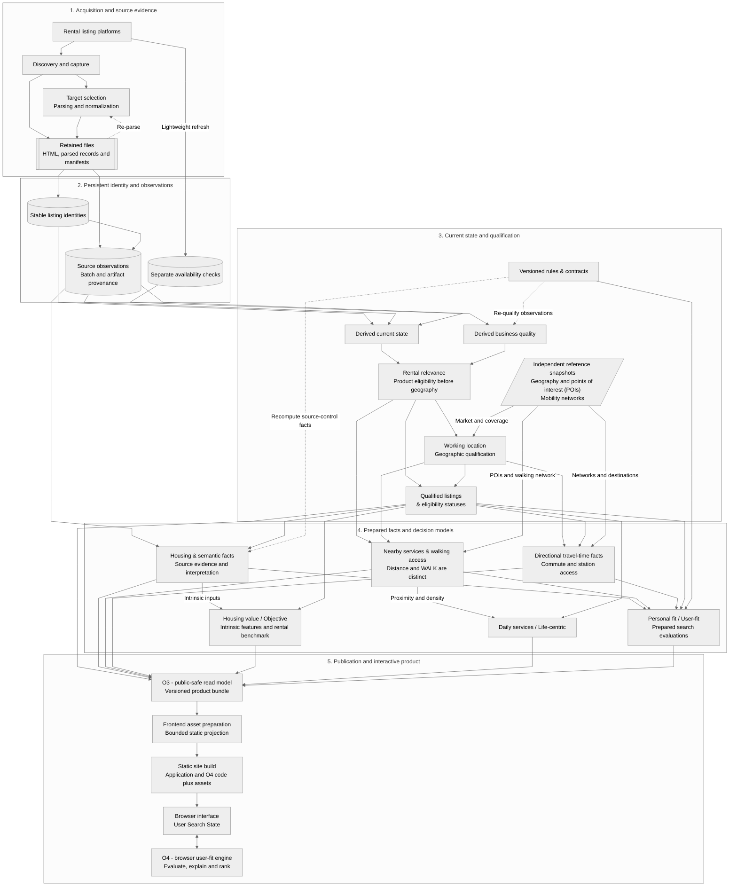

# Pipeline: from a source listing to a usable product fact

[Overview](../README.md) | [Architecture](architecture.md) | [Reproducibility](reproducibility.md)

Rental listings come from different platforms, with inconsistent fields,
missing details and availability that can change over time. Making them
comparable means establishing what was observed, what can be interpreted and
which facts are reliable enough to use in a housing decision.

This document follows that transformation through the real Flincy data path.
The public repository includes representative helpers from the pipeline,
not the complete acquisition, DuckDB or O3 publication workflow.

## Pipeline map — Evidence, persistence and product decisions

This diagram maps the main data responsibilities and dependencies of the real Flincy pipeline. Follow the flow from source capture and persistent observations to current qualification, enrichment, decision models and public delivery. Dashed arrows illustrate selected reprocessing paths; the diagram is a technical reference, not an exhaustive execution graph.



This logical map describes a system broader than the selected public code: double-bordered boxes denote retained files, cylinders denote durable records, and ordinary boxes denote processing or derived results; durable does not mean strictly append-only. Solid arrows show active dependencies, while dashed arrows show distinct, bounded reprocessing triggers that require retained evidence and compatible contracts, not a universal rebuild command. Unknown, unsupported and missing facts remain explicit; travel directions are preserved, and the browser reevaluates personal fit without calculating routes or recomputing housing-value or daily-services scores.

**Ordering fallback:** When user-fit is disabled, an existing Objective rank may order listings within the applicable product and feasibility bands; it is not combined with a User-fit score, and listings without an Objective rank remain explicitly unranked.

## 1. A successful capture is not yet a usable listing

Capturing a page, selecting the intended listing within it, parsing its fields,
and deciding whether it represents a relevant rental are distinct checks.
A syntactically valid price does not establish that an offer is a conventional
rental, and an empty source field is not evidence of absence.

The full system preserves durable listing identity and source observations,
then derives current state. Availability describes what is known about whether
an offer remains available; it is separate from completeness, business quality
and geographic eligibility. A current projection is not a replacement for the
historical observation that supports it.

### Persistent evidence, evolving rules

Flincy retains more than the latest cleaned listing or its final scores.
Reprocessable source artifacts, including captured HTML, parsed and canonical
records, and batch manifests, preserve evidence from earlier processing steps.
Stable listing identities link successive observations. Lightweight availability
checks are recorded separately from full observations, so a new availability
signal does not require replacing the information captured earlier.

This separation allows different kinds of changes without systematically
collecting the same listing again:

- **Parsing rules:** saved source captures can be reparsed to extract or
  reinterpret fields, within the information present in those captures.
- **Product qualification:** persisted observations can be reassessed under
  revised quality or eligibility rules without confusing an earlier decision
  with an original source fact.
- **Enrichment and scoring:** existing facts and versioned references can feed
  recalculated derived features, scores or rankings without necessarily
  repeating acquisition or parsing.

These are bounded reprocessing capabilities, not a promise that every output
can be rebuilt from this Git checkout alone. Recalculation may still require
locally retained data, external reference snapshots and compatible contracts.
Durable records are not all strictly append-only: controlled replays can
replace entries at a defined batch/listing grain while preserving their
identity and provenance.

No captured page, real listing identifier, description or session is included here.

## 2. Interpret the source before merging evidence

Structured fields and description-derived evidence have different provenance.
A source control that explicitly records a negative can support a negative fact.
An unchecked positive-only checkbox need not mean that the feature is absent.

The pipeline therefore keeps interpretation, evidence status and lineage distinct
from a displayed boolean. Description extraction is another source of evidence,
not permission to silently overwrite every structured value. Conflicts and
unknowns must remain visible at the dimensions consumers actually use.

A schematic example, not a real record:

```text
Source observation: unchecked inclusion control
Interpretation: not declared, rather than explicitly absent
Prepared fact: unresolved evidence
Soft preference: not evaluable; reduces coverage, not a confirmed zero
```

The source-specific ingestion and semantic extraction engines are not included.
The [O4 evidence evaluator](../web/fit-engine/src/evaluators.ts) exposes the
downstream distinction between confirmed positive, confirmed negative and
unresolved evidence. The explicit observation policy still matters; not every
missing representation should be collapsed into the same meaning.

## 3. Qualify the product and its location

Business quality establishes whether an observation can enter the relevant
product universe and which scoring inputs are usable. Geography then distinguishes
a usable position, market membership and coverage of the required data.

Points of interest (POIs), such as grocery stores and pharmacies, are linked
to listings through proximity measures. Straight-line distance and calculated
walking access (WALK) are distinct facts: a store can be geographically close
without having a known walking-access result. An unavailable WALK fact cannot
be substituted with a distance estimate.

Routing prepares directional travel-time facts against supported destinations.
A missing route is not an invented large duration; geographic support and a
known failure are different facts.

Network snapshots, location identity, contracts and provenance are part of the
real preparation path. They are not reconstructed by the public synthetic demo.
The selected [delivery helper](../pipeline/frontend_free_anchor_delivery.py)
projects supplied matrices and preserves nulls and status codes; it does not
calculate routes.

## 4. Keep the three score axes separate

**Housing value (Valeur du logement / Objective)** is built upstream from intrinsic
and comparative inputs. **Daily services (Services du quotidien / Life-centric)**
describes neighborhood services. **Personal fit (Adéquation / User-fit)** responds
to a configured search. They answer different questions and are not fused into
one global score.

User-fit separates required travel feasibility from housing eligibility.
Preferences contribute points only when enabled for scoring. Unknown soft facts
reduce weighted coverage instead of becoming confirmed negatives.

The selected [Python scoring helper](../pipeline/user_fit_candidate_v1.py)
contains weight resolution and evidence/aggregation logic. The
[Python explanation helper](../pipeline/user_fit_explanation_v1.py) decomposes
point budgets. These are authentic functions, but their presence does not ship
the orchestration, full configuration catalogs or upstream facts.

## 5. Publish a bounded read model, then prepare delivery

O3 projects public-safe product facts and metadata into versioned assets with
integrity checks. It is not a dump of the observations database. The included
[public bundle helper](../pipeline/public_product_bundle_v1.py) illustrates this
boundary through canonical data, forbidden-field checks, POI relationships and
asset inventory validation. It is not the standalone O3 producer.

A separate frontend preparation step makes the static assets the interface
actually consumes. Not all O3 content is copied unchanged. The delivery test here
checks partitioning and content-addressed output using synthetic data; it does
not publish a real bundle.

## 6. Evaluate an interactive search

The browser resolves interface choices into a Search State and evaluates
prepared facts with O4, without Python, DuckDB or route calculations at runtime.
Housing value and daily-services scores remain upstream values; O4 recomputes
the personal-fit evaluation and ranking as the search changes.

The [synthetic fixture](../web/fit-engine/tests/fixtures/syntheticSearch.ts)
starts at this prepared-input boundary. Its five records and travel durations
are invented, not anonymized production observations. It verifies evidence,
constraints, coverage, explanations and deterministic order without pretending
to exercise the missing acquisition-to-O3 stages.

By retaining source evidence, observations and lineage, Flincy can revisit
interpretations and recalculate decisions as rules evolve. A deterministic
ranking can explain how prepared facts were used, but it cannot turn an
unknown source fact into certainty.
